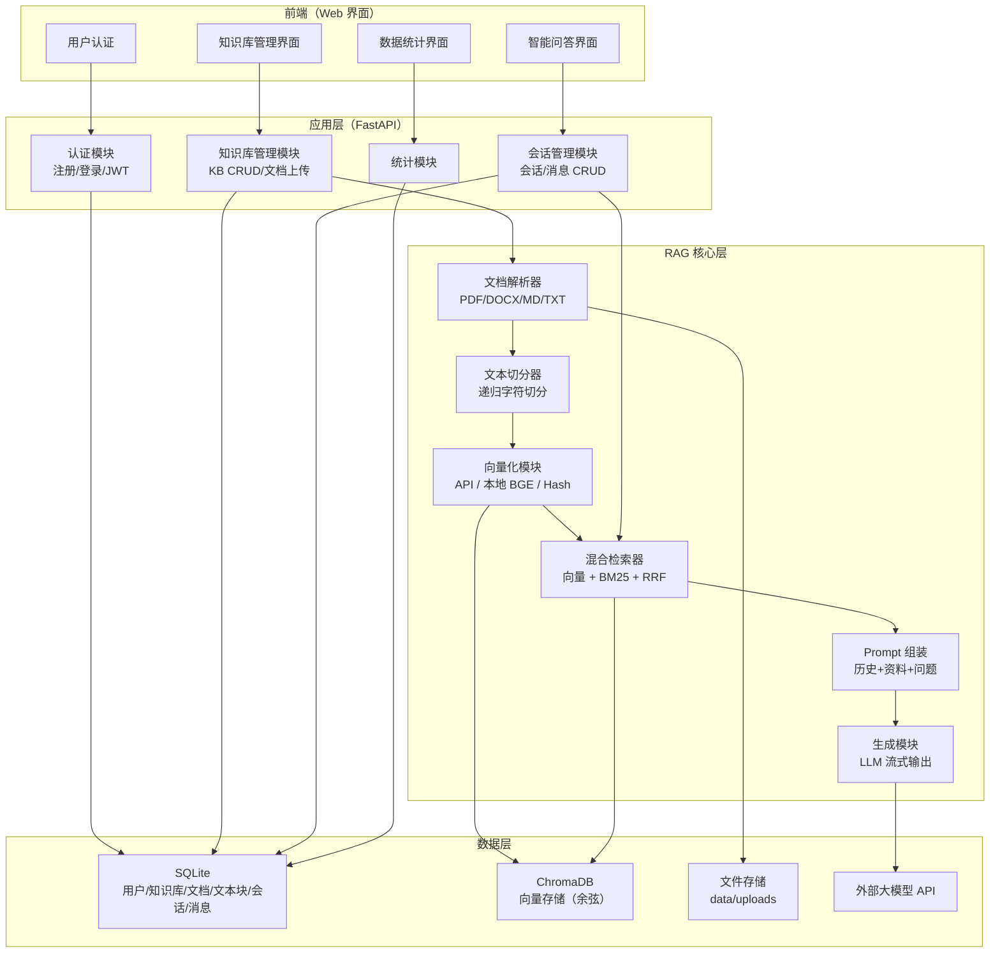
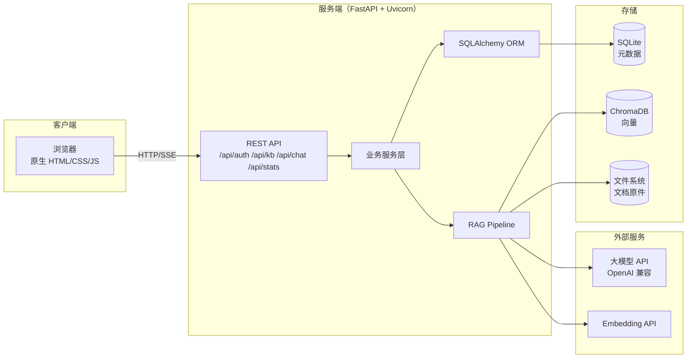
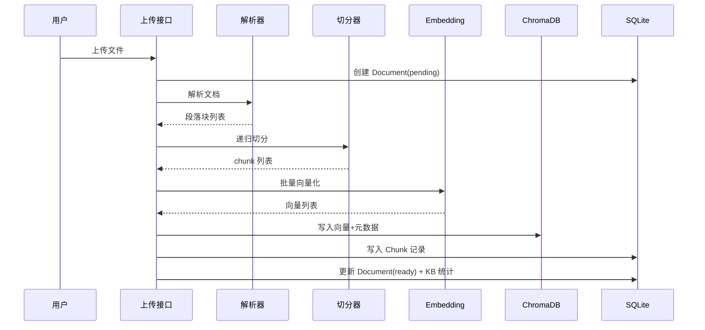
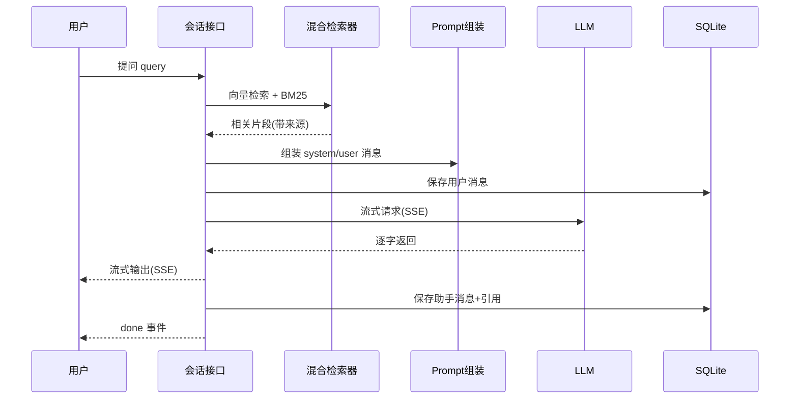
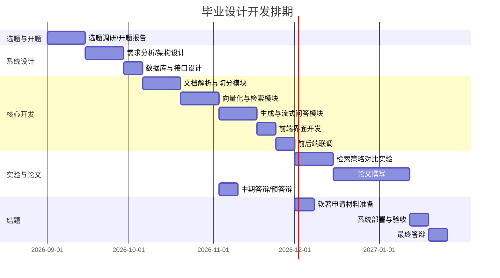

# 毕业设计方案：基于大语言模型的智能领域知识问答系统

> 设计文档版本：V1.0
> 项目类型：应用系统型（NLP 方向 · 检索增强生成 RAG）
> 配套代码：`../app/`（FastAPI 后端 + 原生 Web 前端）

---

## 一、项目背景与意义

### 1.1 背景

随着 ChatGPT 等大语言模型（LLM）的普及，通用大模型虽然知识面广，但在**垂直领域**中存在两个突出问题：

1. **知识时效性差**：模型训练数据存在截止时间，无法回答训练之后的新信息；
2. **领域知识不足**：对特定领域（如校园规章制度、企业内部资料、专业课程教材）的细节知识缺乏掌握，且容易"幻觉"编造答案。

检索增强生成（Retrieval-Augmented Generation, RAG）通过**"先检索、后生成"**的框架，在模型生成前先从外部知识库中检索相关文本片段作为参考依据，从而：
- 让大模型"基于资料"回答问题，显著降低幻觉；
- 回答可以**追溯引用来源**，增强可信度；
- 知识库可随时更新，无需重新训练模型。

### 1.2 意义

本项目设计并实现一个通用的**智能领域知识问答系统**：用户上传文档构建个人知识库，系统基于 RAG 框架进行带引用来源的智能问答。系统具有以下价值：

- **应用价值**：为企业/高校/个人提供"专属知识库问答"能力，适用于制度咨询、学习辅导、产品说明书问答等场景；
- **学术价值**：完整实现并对比了"纯向量检索 / 纯BM25 / 混合检索"三种检索策略，验证 RRF 融合算法对回答质量的影响；
- **工程价值**：形成一套前后端分离、可部署、可扩展的 RAG 参考实现。

---

## 二、研究现状与技术选型

### 2.1 RAG 技术路线

RAG 的典型流程为：**文档加载 → 文本切分 → 向量化 → 向量存储 → 检索 → 重排序 → 生成**。

主流开源方案对比：

| 方案 | 优点 | 缺点 | 本项目选择 |
|------|------|------|-----------|
| LangChain / LlamaIndex | 组件丰富、开发快 | 封装过深，答辩时原理讲不清 | 参考其设计思想 |
| **自研 Pipeline** | 每层可控、原理清晰、便于实验对比 | 需自行实现细节 | ✅ **采用** |

本项目**自主实现** RAG 核心管线，便于在论文中深入阐述每层原理，同时便于完成"检索策略对比实验"这一论文核心章节。

### 2.2 关键选型

| 模块 | 选型 | 理由 |
|------|------|------|
| 后端框架 | FastAPI | 异步高性能、自动生成 Swagger 文档、类型安全 |
| 数据库 | SQLite + SQLAlchemy | 零部署、事务完整，满足单机应用需求 |
| 向量库 | ChromaDB | 持久化嵌入式向量库，无需独立服务，余弦距离检索 |
| 文档解析 | pypdf / python-docx | 支持 PDF 与 DOCX 标题结构提取 |
| 中文分词 | jieba | BM25 关键词检索所需 |
| 大模型 | OpenAI 兼容 API | 可插拔，兼容 DeepSeek/智谱/通义等国内模型 |
| 向量化 | 云端 Embedding API / 本地 BGE | 兼顾效果与部署成本 |
| 前端 | 原生 HTML/CSS/JS | 零依赖、离线可用、部署简单 |

---

## 三、需求分析

### 3.1 用户角色

| 角色 | 说明 |
|------|------|
| 普通用户 | 注册登录、管理自己的知识库、进行问答 |
| 系统管理员 | （扩展）用户管理、系统监控（本期可不做） |

### 3.2 功能性需求

| 编号 | 需求 | 说明 |
|------|------|------|
| FR-1 | 用户注册/登录 | 用户名+密码，JWT 鉴权 |
| FR-2 | 知识库管理 | 新建/修改/删除知识库 |
| FR-3 | 文档管理 | 上传 PDF/DOCX/MD/TXT，查看解析状态，删除、失败重试 |
| FR-4 | 文档解析入库 | 自动完成解析→切分→向量化→入库 |
| FR-5 | 智能问答 | 基于选定知识库问答，支持流式输出 |
| FR-6 | 引用溯源 | 回答标注 [n] 引用编号，可查看原文片段 |
| FR-7 | 会话管理 | 多会话、历史消息查看、删除 |
| FR-8 | 数据统计 | 知识库/文档/文本块/会话/消息统计与可视化 |

### 3.3 非功能性需求

| 维度 | 要求 |
|------|------|
| 性能 | 单文档（≤50MB）解析入库 ≤ 30s；问答首字延迟 ≤ 3s（流式） |
| 可靠性 | 解析失败不中断，可重试；向量库与元数据库一致性 |
| 安全性 | 密码 PBKDF2 加盐哈希；JWT 过期校验；用户数据隔离 |
| 兼容性 | Windows / Linux / macOS；无 GPU 环境可运行 |
| 可维护性 | 分层架构，模块解耦，配置外部化（.env） |

---

## 四、功能模块设计



---

## 五、系统技术架构



### 5.1 核心流程：文档入库



### 5.2 核心流程：智能问答



---

## 六、数据库设计

### 6.1 ER 图

```mermaid
erDiagram
    USERS ||--o{ KNOWLEDGE_BASES : "拥有"
    USERS ||--o{ CONVERSATIONS : "发起"
    KNOWLEDGE_BASES ||--o{ DOCUMENTS : "包含"
    KNOWLEDGE_BASES ||--o{ CHUNKS : "对应"
    DOCUMENTS ||--o{ CHUNKS : "切分为"
    CONVERSATIONS ||--o{ MESSAGES : "包含"

    USERS {
        int id PK
        string username UK
        string password_hash
        datetime created_at
    }
    KNOWLEDGE_BASES {
        int id PK
        int user_id FK
        string name
        text description
        int doc_count
        int chunk_count
        datetime created_at
    }
    DOCUMENTS {
        int id PK
        int kb_id FK
        string filename UK(kb,filename)
        string file_path
        string file_type
        int file_size
        string status "pending/processing/ready/failed"
        int chunk_count
        text error_msg
        datetime created_at
    }
    CHUNKS {
        int id PK
        int kb_id FK
        int doc_id FK
        int seq
        text content
        json meta "page/heading"
        string vector_id "ChromaDB id"
    }
    CONVERSATIONS {
        int id PK
        int user_id FK
        int kb_id
        string title
        datetime created_at
        datetime updated_at
    }
    MESSAGES {
        int id PK
        int conversation_id FK
        string role "user/assistant"
        text content
        json sources "引用来源"
        int tokens
        datetime created_at
    }
```

### 6.2 关键设计说明

| 表 | 设计要点 |
|----|----------|
| users | 密码存 `pbkdf2_sha256$迭代次数$盐$摘要`，不存明文 |
| knowledge_bases | `doc_count/chunk_count` 为冗余统计字段，减少聚合查询 |
| documents | `status` 状态机：pending → processing → ready / failed；`(kb_id, filename)` 唯一约束防重复上传 |
| chunks | `meta` 存 JSON（页码/标题），`vector_id` 关联 ChromaDB 向量，保证"SQLite 与向量库"双写一致 |
| messages | `sources` 存 JSON 引用快照，历史消息可直接回放引用来源 |

**一致性策略**：删除文档时，先删 ChromaDB 中对应 `vector_id` 集合，再删 SQLite 记录；删除知识库时整体删除向量 collection，保证两份存储无孤儿数据。

---

## 七、核心算法设计

### 7.1 递归字符切分

按分隔符优先级 `段落(\\n\\n) → 句子(。！？；) → 标点(，) → 字符` 在不超过 `CHUNK_SIZE` 的窗口内从后向前寻找最优切分点，相邻块保留 `CHUNK_OVERLAP` 重叠，避免跨块上下文断裂。

默认参数：`CHUNK_SIZE=500`、`CHUNK_OVERLAP=80`（可配置）。

### 7.2 混合检索（向量 + BM25 + RRF）

单一检索方式的局限：
- **向量检索**：擅长语义相关，但对精确关键词（如型号、编号）不敏感；
- **BM25**：擅长词面匹配，但无法理解同义表达。

本项目采用**加权 RRF（Reciprocal Rank Fusion）**融合：

$$\text{RRF}(d) = \sum_{r \in R} \frac{1}{k + r(d)}, \quad k = 60$$

其中 $r(d)$ 为文档 $d$ 在某个检索方式结果中的排名。融合后按 RRF 分数取 Top-K，同时保留两种检索方式的优势。

### 7.3 Prompt 工程

三段式 user 消息构造：**对话历史（最近6条） + 参考资料（带[编号]与来源信息） + 当前问题**，配合系统指令约束：
- 只依据参考资料回答，禁止编造；
- 资料不足时明确说明；
- 句末标注 `[n]` 引用编号。

### 7.4 流式输出（SSE）

问答接口通过 Server-Sent Events 逐字返回生成内容，事件类型：
`sources`（引用来源）→ `delta`（增量文本）→ `done` / `error`。

---

## 八、开发排期

### 8.1 总体排期（16 周）



### 8.2 里程碑

| 里程碑 | 时间 | 交付物 |
|--------|------|--------|
| M1 开题 | 第 2 周 | 开题报告 |
| M2 核心检索跑通 | 第 8 周 | 可检索 demo（离线模式） |
| M3 全流程可跑 | 第 12 周 | 完整系统 + 真实 API |
| M4 实验完成 | 第 14 周 | 对比实验数据 |
| M5 论文/软著 | 第 16 周 | 论文定稿 + 软著材料 |

---

## 九、实验与评测方案

> 论文"实验"章节的核心内容：证明混合检索优于单一检索。

### 9.1 实验数据集

选取某领域文档（建议 10~20 篇，如课程教材/规章制度/技术手册），人工构造 **50~100 条问答对**，标注每条的参考答案与期望来源文档。

### 9.2 评测指标

| 指标 | 说明 |
|------|------|
| 检索召回率 Recall@K | 期望来源出现在前 K 条检索结果中的比例 |
| 回答忠实度 | 回答中是否存在与参考来源矛盾的内容（人工评估 1~5 分） |
| 回答完整度 | 是否覆盖参考答案要点（人工评估 1~5 分） |
| 首字延迟 | 流式输出第一个字符的时间 |

### 9.3 对比实验设计

| 实验组 | 检索方式 | 变量 |
|--------|----------|------|
| E1 | 纯向量检索 | TOP_K=5 |
| E2 | 纯 BM25 | TOP_K=5 |
| E3 | 混合检索（本项目） | RRF 融合，BM25 占比 40% |
| E4 | 混合检索 + 不同 TOP_K | TOP_K = 3/5/8 |
| E5 | 不同切分参数 | CHUNK_SIZE = 300/500/800 |

**预期结论**：E3 的 Recall@K 与回答质量优于 E1/E2；E5 验证切分参数对检索效果的影响——构成论文中"消融实验"章节。

---

## 十、答辩要点

### 10.1 项目创新点（答辩陈述核心）

1. **混合检索策略**：不盲目追求向量检索，而是设计"向量语义 + BM25 关键词 + RRF 融合"的混合方案，兼顾语义理解与精确匹配，并用实验量化验证；
2. **可追溯问答**：回答强制标注引用编号并展示原文片段，解决大模型"幻觉"问题，这是 RAG 相对传统问答系统的核心价值；
3. **分层自研管线**：不依赖 LangChain 等黑盒框架，自主实现解析/切分/检索/生成全流程，每层原理可讲透、可优化；
4. **低成本可部署**：嵌入式向量库 + 云端 API，无 GPU 也能完整运行，具备落地可行性。

### 10.2 高频答辩问题与应对

| 老师可能提问 | 回答要点 |
|--------------|----------|
| 为什么要用 RAG 而不是微调？ | 微调需要大量标注数据与 GPU，且无法解决知识时效性；RAG 无需训练、知识库可动态更新、可追溯来源 |
| 向量检索和 BM25 各有什么优缺点？ | 向量：语义相似但精确匹配弱；BM25：词面匹配强但无语义。故融合 |
| RRF 融合的原理？ | 基于排名的融合，不依赖分数归一化，k=60 为经验参数 |
| 如何解决幻觉？ | 限定只依据检索内容回答 + 引用标注 + 检索不到时拒答 |
| 中文切分与英文有什么不同？ | 中文无空格分词，切分优先按段落/句号/分号，BM25 需 jieba 分词 |
| 系统如何扩展？ | 增加文档类型（爬虫/音视频转写）、增加重排序层、支持多用户权限 |
| 数据库与向量库如何保证一致？ | 事务化处理：先写向量库再写 SQLite，删除时先删向量再删记录，文档级幂等 |

### 10.3 演示脚本（答辩现场）

1. 登录 → 新建知识库"校园规章制度" → 上传 2 个 PDF（提前准备好，避免现场网速问题）；
2. 提问："请假流程是什么？" → 展示流式回答与引用编号；
3. 点击引用 chip → 展示原文片段与页码；
4. 提问一个资料中没有的问题 → 展示"根据现有资料无法回答"；
5. 打开统计页展示数据仪表盘；
6. 演示切换知识库提问，展示数据隔离。

> 建议：现场使用离线演示模式（echo+hash）作为保底方案，避免 API 故障。

---

## 十一、部署与运行

见根目录 `README.md`。要点：`pip install -r requirements.txt` → 配置 `.env` → `uvicorn app.main:app --port 8000` → 浏览器访问。

---

## 附录：与"师姐项目"的对照（供开题参考）

| 维度 | 师姐项目（AQI 预测） | 本项目 |
|------|---------------------|--------|
| 核心任务 | 深度学习回归/分类预测 | 大模型检索增强生成 |
| 模型 | 自训练深度模型 | 大模型 API（免训练） |
| 数据处理 | 结构化时序数据 | 非结构化文档 |
| 系统形态 | Web 预测服务 + 可视化 | Web 问答系统 + 引用溯源 |
| 技术前沿性 | 经典深度学习 | 2024-2026 主流大模型应用 |
| 实验形式 | 模型精度对比 | 检索策略消融实验 |
